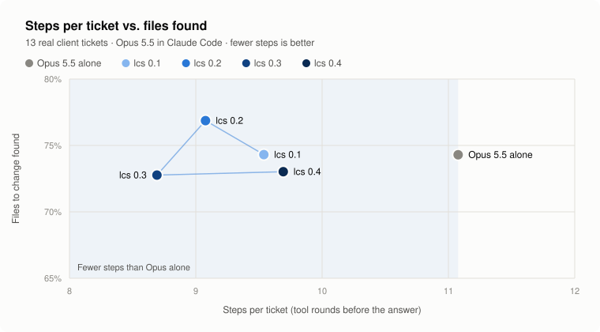

<p align="center">
  <picture>
    <source media="(prefers-color-scheme: dark)" srcset="assets/lcs-dark.svg">
    
  </picture>
</p>

# local-code-search

Local code search for AI coding agents. lcs gives Claude Code, Codex or Cursor the right piece of code, a
`file:line` with its snippet, found by meaning and by keywords. It runs on your machine, on the GPU when
there is one, with no cloud and no telemetry.

## Does it help the agent?

<p align="center">
  <picture>
    <source media="(prefers-color-scheme: dark)" srcset="assets/benchmark-dark.svg">
    
  </picture>
</p>

|  | Opus 5.5 alone | with lcs |
|---|---|---|
| Steps per ticket (fewer is better) | 10.6 | **8.8** |
| Files to change found (more is better) | 58% | 57% |
| Cost per ticket | $0.30 | **$0.26** |

Claude Code (Opus 5.5) had to find the files to change for 90 real tickets of a client project, once
with its usual tools and once with lcs. A step is one round of tool calls before the answer. With lcs the
agent needs 17% fewer steps and costs 12% less, for the same accuracy. The
[method](docs/how-it-works.md#benchmark-method) gives the details.

## Setup

Paste this into Claude Code.

```text
Install local-code-search (https://github.com/djdevpro/local-code-search).
Download the lcs binary for this system from the latest release, put it in my PATH
and check that `lcs --version` works.
When a project would benefit from it, ask me first, then run `lcs --root <project> init`.
Index a project only when we start working on it, with `lcs --root <project> index`.
```

`init` registers this MCP server in Claude Code, Codex and Cursor, and adds a short guide for the agent.

```bash
lcs --root /path/to/project serve
```

Binaries cover Windows x64, Linux x64 and Apple Silicon. Anywhere else, run
`cargo install --git https://github.com/djdevpro/local-code-search`. `lcs update` installs new releases.

## The MCP tools

`search` finds code by meaning and by keywords and returns one result per file, with `file:line` and the
lines that match. Agents should call it **instead of grep** to locate or understand code, and keep grep
for exhaustive or literal searches, like every call of a function or an exact string. `def` returns the
exact definition of a symbol. `status` shows the state of the index.

Each search runs BM25 on the keywords and the embedded model on the meaning, then merges both rankings
with Reciprocal Rank Fusion (RRF).

## Performance

Indexing 50,000 files takes 43 s for the keywords. A hybrid search answers in 23 to 40 ms at p95, and in
8 to 10 ms on keywords only. The GPU embeds 66 to 140 chunks per second, and code already seen is never
embedded twice.

[How it works](docs/how-it-works.md) explains the pipeline, the commands and the configuration.
License MIT OR Apache-2.0.
