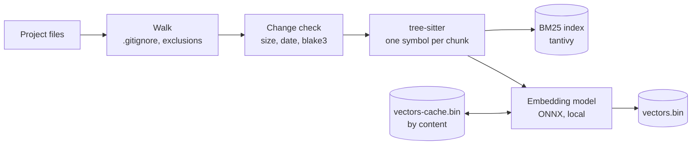
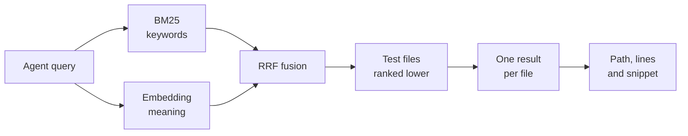
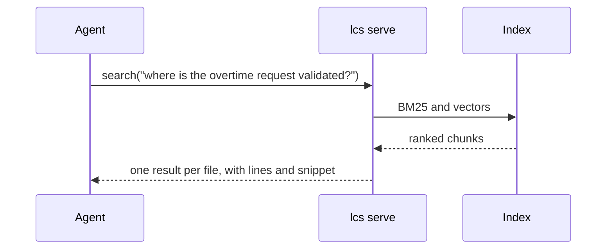

# How lcs works

lcs keeps an index of your project on your machine and answers the agent's searches in a few tens of
milliseconds. It reads only the files that changed, embeds only the code it has never seen, and sends
nothing over the network.

## Indexing



lcs walks the project with the rules of `.gitignore`, skips hidden folders and the usual heavy ones
(`node_modules`, `target`, `dist`, `build`, `vendor`, virtual environments), then applies the `exclude`
list of the configuration. It also skips binary files, minified files and files over 20 MB, and it
reports what it skipped. A file is read again only when its size or date changed and its blake3 hash
confirms a new content.

tree-sitter cuts Python, TypeScript, JavaScript, Rust, Go and PHP into symbols, so a function, a class
or a method becomes one chunk. Each chunk starts with a header that holds its path, its parent, its
signature and its doc comment. Bodies over about 1,000 tokens are split. Other text files become windows
of 40 lines. A chunk keeps the same id when lines move above it.

The BM25 index uses a tokenizer made for code. Each identifier gives the whole word and its parts at the
same position, so `get_connection_pool` matches `get_connection_pool`, `get`, `connection` and `pool`.
There is no stemming and no stop word list. Keyword search works as soon as this step ends, and the
vectors follow.

The default model is `Alibaba-NLP/gte-modernbert-base`, downloaded once from Hugging Face and run with
ONNX Runtime. The CPU uses an int8 version. The GPU uses the fp32 version, because fp16 returns zeros on
DirectML. With `--device auto`, lcs picks DirectML on Windows and CUDA on Linux, and falls back to the
CPU with a message if the GPU fails. On macOS it uses the CPU, and CoreML only on request.

Vectors live in `vectors.bin`, an append-only file of f16 records with a checksum each. Search is exact,
a dot product with every vector held in memory. `vectors-cache.bin` keeps each vector under a hash of the
chunk text, so a branch switch, a revert or a moved function reuses vectors instead of computing them
again. The cache holds at most twice the live chunks and drops the oldest first. A new model empties it.

## Search



Each query runs on both lists at once, and Reciprocal Rank Fusion merges them. A chunk scores the sum of
weight / (k + rank) over the lists where it appears, with a weight of 0.3 for BM25, 1.0 for the vectors
and k = 60. These values come from tests on SciFact, NFCorpus, CosQA and real agent questions. Ties are
broken by path and line, so the same query always gives the same order.

Test files keep half their score. lcs then keeps the best passage of each file and lists the other
matching passages of that file under it, so ten results show ten different files.

The answer stays small. Definitions come first, each snippet focuses on the lines that match the query,
and past 1,500 tokens the remaining results are only `file:line`. The query is embedded on the CPU even
when the documents use the GPU, because a GPU reconfigures itself for every text length, about 200 ms
against 20 ms on the CPU.

A cross-encoder reranker exists but stays off. It will be switched on only if the benchmark shows a gain.

## The MCP server



`lcs serve` speaks MCP over stdio and exposes three tools, `search`, `def` and `status`. The tools load
upfront. When Claude Code defers them behind its tool search, the agent ignores lcs, so `lcs init` sets
`alwaysLoad` and the server marks its tools the same way.

The server tells the agent to write queries in the language of the code, usually English, with the
words of the code, class and function names included. It asks the agent to trust the results, to read
only the lines it needs, and to keep grep for exhaustive or literal searches.

While it runs, the server watches the files and updates the index 400 ms after the last change. It
computes vectors in short batches, so a search never waits long. The first search of a session loads
the model in about 4 seconds. Later searches take tens of milliseconds.

## lcs init

`lcs init` connects lcs to the coding agents of a project. It keeps existing settings and saves a `.bak`
copy of each file it changes. `--dry-run` shows the changes first.

- Claude Code gets `.mcp.json` and a section in `CLAUDE.md`.
- Codex gets `.codex/config.toml` and a section in `AGENTS.md`. Codex loads it in approved projects only.
- Cursor gets `.cursor/mcp.json` and the rule `.cursor/rules/local-code-search.mdc`.

Claude Code is always set up. Codex and Cursor are set up when they are installed or used in the project.

## Commands

| Command | What it does |
|---|---|
| `init [--dry-run]` | sets lcs up in Claude Code, Codex and Cursor |
| `index [--no-embed]` | updates the index and reads changed files only |
| `search <query> [--mode bm25\|vector\|hybrid] [-n N] [--json] [--passages]` | ranked results, one per file unless `--passages` |
| `def <name>` | exact definition of a symbol, `Parent::name` accepted |
| `serve` | MCP server over stdio, with automatic index updates |
| `watch` | updates the index on every change |
| `status` | index statistics and measured counters |
| `config` | effective configuration |
| `bench <set.jsonl>` | file-level evaluation with acc@k, recall@10, MRR and nDCG@10 |
| `update [--check]` | installs the latest release after checking its SHA-256 |

Every command takes `--root <folder>` and `--device auto|cpu|cuda|directml|coreml`.

## Configuration

lcs reads `local-code-search.toml` at the project root, or the file named by `LCS_CONFIG`. Every option
is optional, and `--device` on the command line wins over the file.

```toml
device = "auto"

[model]
embedder = "Alibaba-NLP/gte-modernbert-base"   # or a local folder
onnx_file = "onnx/model_int8.onnx"             # CPU
onnx_file_gpu = "onnx/model.onnx"              # GPU

[index]
data_dir = ".lcs"
languages = ["python", "typescript", "javascript", "rust", "go", "php"]
exclude = []

[search]
rrf_k = 60.0
bm25_weight = 0.3
vector_weight = 1.0
results = 10
test_penalty = 0.5

[output]
token_budget = 1500
```

## Privacy

lcs opens two outbound connections, both on demand. The first downloads the model from Hugging Face the
first time it is needed. The second is `lcs update`, which reads the GitHub releases. `tests/egress.rs`
fails the build if a new connection appears in the code.

## Benchmark method

Claude Code (Opus 5.5) received 13 real tickets from a client project of about 4,000 files. Each ticket
was replayed at the commit of its time in a fresh session, which had to list the files to change without
changing anything. One setup had the usual tools of Claude Code, the other had the same tools plus lcs.
The score counts the steps, one round of tool calls each, and the share of files found among those
changed in the original work. Both setups ran with an API key, a minimal environment and maximum effort,
one run each. Time is not compared, because it depends on the load of the API. The code and the tickets
stay private.
